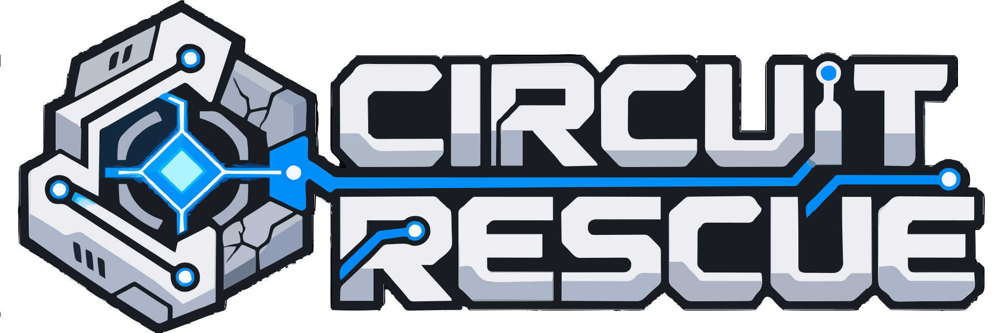

# Circuit Rescue



A pixel-art logic-gate adventure built in **GDevelop 5**. Explore eight space-station sectors, collect varied materials, and repair machinery through circuit dialogs with direct port connections. Activate a rideable mecha in sector 6, then defeat the guardians in sectors 7–8. Developer credits are available from the menus.

The project filename remains **Animal Hunter.json** for compatibility with existing repository tools. Its game title is **Circuit Rescue**. See the [campaign guide](docs/circuit-rescue-campaign.md) for sector objectives, circuit ports, controls, combat and implementation limits.

## Language and level navigation

New players start in **Bahasa Indonesia**. The speech-bubble/globe icon on the opening/result screens and pause menu switches between Indonesian and English; the selected language is saved in the browser. Standard gate symbols (AND, OR, NOT, XOR, NAND and NOR), the game title, developer names and NIMs remain unchanged. Menus, HUD messages, rules, hints and challenge feedback use the selected language.

The route icon opens all **eight levels**, with no unlock requirement. Selecting one starts a fresh run at that level; levels 7–8 start with the mecha. Every entry shows a paused introduction with the gate concept, binary-signal explanation, worked example and mission. Start Level begins gameplay.

Reaching a powered exit opens **Level Complete** instead of advancing automatically. Choose **Next Level**, **Level List** or **Main Menu**; the final level offers **View Ending**. Returning from the level list restores the completion dialog. Main-menu Play continues with the next level after a completion. Completion badges are saved locally, but the active run, inventory, health and score are still session-only.

The new navigation icons and completion badge use generated artwork in [navigation/](assets/circuit-rescue-v1/navigation/PROMPTS.md). Run `npm run test:localization` and `npm run test:journey` for language and navigation checks; the browser test requires an HTML5 export first.

On mobile, the generated expand/contract control toggles fullscreen for the entire app, including its HTML dialogs and touch controls. Introductions and challenges include their own fullscreen control. A supported browser must receive a user tap; rejected requests show a localized explanation and leave the game usable. On iPhone browser tabs, the control instead offers Safari Home Screen installation instructions on demand. Home Screen web apps are detected through iOS standalone mode and the standard display-mode media queries; fullscreen controls and unsupported warnings are hidden there, since the app already runs without normal browser bars. Unsupported browsers do not show a persistent warning over gameplay. Landscape orientation is requested when supported. Browser/system exit controls remain available.

The mobile game surface blocks page scrolling/overscroll, pinch/double-tap zoom, long-press menus, selection and native image dragging. Single-finger dialog scrolling and editable inputs remain usable; desktop browser defaults are untouched. Run `npm run test:mobile-browser` for fullscreen and gesture-policy checks. These tests simulate iPhone capabilities and standalone state in Chromium; they do not replace physical iPhone/Safari testing.

## Open and play

1. Clone or download this repository, including its `assets/` directory.
2. In GDevelop, choose **Open a project** and open **[Animal Hunter.json](Animal%20Hunter.json)** at the repository root.
3. Preview the project to start at the opening menu, or preview `permainan` directly while developing the level.

The project was last saved with GDevelop **5.6.283**. Use GDevelop to edit and preview it. Node.js **24** is used for optional automated tests and HTML5 exports; install the locked development tools with `npm ci`.

## Controls

| Action | Keyboard / control |
| --- | --- |
| Move | Arrow keys or A / D |
| Jump | Space or W; briefly hold for a higher jump |
| Shoot | J or X; hold to repeat |
| Use terminal / board mecha | E, while near the object |
| Mecha shield | Hold K; release to recharge |
| Pause / continue | P or Escape; pause/play icon |
| Help | H or question-mark icon |
| Replay | R or circular-arrow icon |
| Return to opening | House icon in the pause/result menu |
| Start | Enter or the large play icon |
| View credits | People icon in opening, pause and result menus |

Escape closes help/credits. Credits opened from the pause panel return to that paused panel.

Phones and touch tablets automatically show generated movement, jump, fire, interact and pause/continue buttons. Desktop computers, narrow desktop windows and mouse-first touch laptops keep the mobile overlay hidden. Detection combines mobile-device hints, touch capability and the primary pointer/hover signals; width alone never enables the controls. Portrait/landscape state updates as the device rotates. Hold multiple controls together to move while firing or jumping. The shield button appears with the mecha. Buttons release on pointer cancellation, focus loss and dialog entry; quick action taps are buffered until the next game frame. Keyboard controls remain available. The fixed 1280×720 game view scales to fit smaller screens so HUD elements remain visible; landscape is recommended. Controls respect screen safe areas. Run `npm run test:mobile` after exporting for browser regression checks; physical-device testing is still needed.

## Gameplay

- **Eight locations / 24 challenges:** a station, warehouse, transit network, tower, reactor, hangar, battlefield and guardian core. Each has three separate terminals across vertical or branching routes.
- **Native platformer physics:** gravity, acceleration, jumping, and terrain collision use GDevelop's Platformer / Platform behaviors.
- **Combat:** patrol drones take two shots and damage the player on contact. They can also be stomped from above.
- **Supplies:** start with 3 health, 3 lives, and 40 rounds. Ammo pickups give 8 rounds, up to 40; medkits restore one health. Each sector requires three component chips.
- **Checkpoints:** the flag restores health and saves a respawn position. Falling or losing all health costs one life.
- **Dialog missions:** predict outputs with draggable 0/1 tokens, repair a wrong chip and broken wire, then build a circuit. Later quizzes include three inputs and a NAND-only interlock. Circuit cables automatically connect in four directions; testing rejects short circuits, feedback and disconnected ports. Incorrect answers consume no components.
- **Progression:** terminals need one, two and three recovered components. Complete all three systems before leaving. All three repairs power the airlock.
- **Mecha:** repair and board it in sector 6. Six hull points, unlimited cannon shots and a rechargeable shield support combat in sectors 7–8.
- **Boss:** Bastion, a yellow siege walker in sector 7, and the three-phase Crimson Warden sword guardian in sector 8. Later shield phases require new circuit repairs. Combat pauses during dialogs.
- **Results:** dedicated station-restored and mission-failed scenes show final score and component count, with replay/home controls.
- **Developer credits:** available from the opening, pause and result menus. Gameplay contains no credits chest or keycard pickup.
- **Icon HUD:** pause, continue, replay, home, help, and credits use the game's artwork instead of text labels on buttons.

Maps have individual dimensions from 2000–6000 units wide and 1400–2400 units tall. The final arena widens the camera view and frames the player with the nearby active boss. The camera follows both axes; background and HUD remain fixed. Native one-way platforms support climbing and return routes. See [location layouts](docs/location-layouts.json) for dimensions, room positions and route measurements. The current combat pack has **36 actor actions and four projectile animations, eight frames each (320 frames)**. The older combat pack is retained as source history. Mecha/boss runtime frames are 256×256; the regenerated Warden uses 128px source cells expanded with nearest-neighbor sampling. Original detailed sheets are retained. Normal robot frames remain 128×128. The small robot has 64 recreated source frames, including its own eight-frame Land action; live Idle uses the stable ready pose.

Play continues the current sector during the running session, or the next sector after a completion. The opening replay icon begins a new campaign; gameplay replay restarts the current sector. Active-run progress resets when closing the game; language and completion badges remain in browser storage. Audio, persistent run saves and a full crafting inventory are not implemented yet.

## Repository layout

```text
Animal Hunter.json                 Main GDevelop project
assets/
  circuit-rescue-v1/                Active station, robot, UI, cables and giant robot assets
  cowboy-island-pack-v1/            Player frames, terrain, props, enemies, effects and UI
  animal-hunter-ui-v1/              Title logo and menu/result icons
  developer-portraits-v1/           Supplied developer portraits
  legacy/
    root/                          Earlier loose artwork, preserved for reference
    imports/                       Earlier editor-imported frames and textures
docs/
  game-guide.md                    Scenes, game rules, events and tuning
  chest-credits.md                 Developer credit details
  asset-audit.json                 Resource-catalog cleanup record
src/events/
  campaign.js                      Sector objectives, circuit dialog/model and mecha boarding
  combat.js                        Guard/boss AI, telegraphs, hostile shots and arena cover
  gameplay.js                      Editable game-rule event source
  ui.js                            Shared menu, HUD, pause and credits source
scripts/
  test-circuit-model.mjs           Functional truth-table and invalid-network tests
  generate-circuit-cables.mjs      Exact-grid cable asset generator
  check-project.mjs                Project/resource/JavaScript checks
  sync-events.mjs                  Pull or push event source
package.json                       Optional maintenance commands
.gitignore                         Local recovery/editor/output exclusions
.gitattributes                     Consistent text line endings and binary asset handling
```

`assets/legacy/` preserves older artwork; it does not contain the main player or menu assets used by the current game. Existing generated asset folders keep their names so their manifests and references stay understandable. The active project's resource catalog contains only retained references; obsolete unused registrations were removed without deleting the artwork.

Local backups, autosaves, prepared-project copies, old runtime reports, contact-sheet previews, and one-off import helpers are preserved under **`.local/`** and excluded from Git. Use Git history for shared historical versions. `.git/` and the current branch are unchanged.

## Development workflows

### Editing in GDevelop

1. Open `Animal Hunter.json` and edit scenes, object properties, behaviors, or events.
2. Save the project.
3. If you changed JavaScript events, update the readable source files:

   ```sh
   npm run events:pull
   ```

4. Run the repository checks, then preview the affected scenes in GDevelop:

   ```sh
   npm run check
   ```

### Editing the JavaScript source

1. Close the project in GDevelop to prevent an older open editor state from overwriting the update.
2. Edit `src/events/campaign.js`, `src/events/gameplay.js`, `src/events/ui.js`, `src/events/localization.js` or `src/events/journey.js`.
3. Review the planned synchronization and apply it:

   ```sh
   npm run events:push -- --dry-run
   npm run events:push
   npm run check
   ```

4. Reopen `Animal Hunter.json` and preview the game.

The push command updates matching embedded events and creates an ignored recovery copy in `.local/backups/event-sync/`. UI, localization and journey sources are shared across all eleven scenes; gameplay, campaign and combat sources are shared across eight sectors. Localization initializes first and journey renders/translates last. Pulling stops if shared copies differ. These commands also work as `node scripts/sync-events.mjs pull` / `push` and `node scripts/check-project.mjs`. Run `npm run test:circuits` to verify all lesson functions, guardian phase targets and invalid wiring.

The main project remains the source of truth for scene layouts, object definitions, behaviors, and event structure. Source files and embedded JavaScript are synchronized explicitly; there is no background auto-sync.

### Vector UI and modal motion

The level list, introductions, completion choices and circuit workbench share a charcoal palette inspired by [ConnectKit's dark theme](https://github.com/family/connectkit/blob/main/packages/connectkit/src/styles/themes/base.ts): `#2B2B2B` surfaces, `#333333` inset sections, `#383838` buttons, white text and blue accents. Muted instructions use a brighter gray for readability. Native menu, pause/help/credits, result and HUD styling follows the same palette and text hierarchy. The opening and result screens use the full SVG logo; modal reveals use its isolated emblem.

The workbench groups gates, Connect, Trim and undo/redo above the board. Both gate inputs sit on the left and the output on the right. Drag or tap ports to connect them; cables route automatically. Outputs support fan-out, input rewiring replaces one connection, and crossing cables remain separate. There is no cell-by-cell wire painting. Input previews sit with the target table. One primary Check/Test action is followed by small Clear, Hint and Help controls. Help and hints open only on request and close with Escape before the dialog itself closes. Editing clears stale validation results without repeating instruction banners. Attempt/hint counts remain in completion summaries. Different dialog views and challenge stages crossfade and resize over 180 ms without replaying the full branded reveal. Language selection within the same view updates quietly and retains focus. Icon hover effects are contained inside their buttons and cancel on click, pointer exit, modal swap or dismissal; delayed requests are invalidated too. Text buttons use CSS interaction states. Touch targets, focus rings and fullscreen notices share the same styling.

Edit icon geometry, resource mappings, palette values and timing in [the vector UI manifest](assets/circuit-rescue-v1/vector-ui/manifest.json), and modal styles in [the CSS template](src/ui/modal-theme.css). Run `npm run assets:svg` to regenerate the 29 SVG symbols, sprite, CSS and native-preview stylesheet fallback. Generated files should not be edited directly. Thirty-five existing resource names now point to SVGs; the original raster files remain available. The mapped image files shrink from about 6.7 MB to 15 KB counted across resource references; the game still loads raster scenery and actor frames.

The HTML5 build bundles **Anime.js 4.5.0** locally and loads [the modal controller](src/ui/modal-motion.js). The generated reactor emblem is isolated from the full wordmark in [the emblem SVG](assets/circuit-rescue-v1/branding-v2/circuit-rescue-emblem.svg). A hexagonal opening frame surrounds the enlarged emblem, which scales up to 224px while fitting smaller viewports. It winds back slightly, turns clockwise like tightening a wrench, then fades as the shell and inner surface expand. Closing reverses that sequence: the panel folds into the hexagon, the emblem turns back, and the frame clears. Opening and closing each take about 600 ms. Scene changes wait for dismissal. Gameplay stays paused through dismissal, focus returns to the previous control, and reduced-motion settings remove movement and delays. Rotation, interrupted reveals and dialog removal clean up temporary layers. The native GDevelop preview uses the shared static theme; the animated controllers currently load through `npm run build:web`.

Local **Lottie Web 5.13.0** playback rotates the emblem SVG forward or backward and supplies brief hover feedback for HTML interface icons. The 29 icon definitions and retained button-feedback source file contain vector shapes. The logo animation references the local emblem SVG and holds its final pose until the reveal clears; it contains no wordmark or raster image. Expansion waits for the turn to complete. A bounded SVG/Anime.js fallback keeps the dialog usable if Lottie cannot load. No animation loops. Icon files load on demand and SVGs remain the loading/error/reduced-motion fallback. Native GDevelop sprites continue using SVG textures. Edit icon geometry in the manifest, then regenerate; [the converter](scripts/lottie-shapes.mjs) preserves curves, strokes and fills. [The interaction controller](src/ui/lottie-icons.js) cleans up playback on removal, scrolling, resize and backgrounding.

Modal typography follows [ConnectKit's font stack](https://github.com/family/connectkit/blob/main/packages/connectkit/src/styles/index.ts) and [hierarchy](https://github.com/family/connectkit/blob/main/packages/connectkit/src/components/Common/Modal/styles.ts): 17px/600 titles, 19px/600 section headings, 16px body text and 13px supporting text. Tutorials use plain-language situations in Indonesian and English. Equations and arrow navigation icons were removed from introductions and buttons; binary values remain on the puzzle board. Optional combat advice expands separately.

After `npm run build:web`, run `npm run test:modals` for animation lifecycle, pause/focus, reduced-motion and viewport checks. Run `npm run test:journey`, `npm run test:browser` and `npm run test:mobile` for the surrounding game flows. These are behavioral checks; the user reviews the appearance. The [reference study](docs/ui-reference-study-2026-11-23.md) records the sampled motion reference and design decisions.

## Scenes and event groups

| Scene | Purpose |
| --- | --- |
| `opening` | Title, play, help, credits and exit |
| `permainan` | Sector 1: NOT lesson and adventure |
| `sector2`–`sector5` | AND, OR, XOR and NAND modules |
| `sector6` | Combined circuit and rideable mecha activation |
| `sector7` | NOR module and siege guardian |
| `sector8` | Three-phase Core Guardian and final repairs |
| `winner` | Ending, final run data, replay/home/credits |
| `game over` | Loss result, final run data, replay/home/credits |

Gameplay events are grouped into campaign missions, icon UI, native Platformer controls and game rules. The gameplay source selects player animation once per frame; native animation actions do not compete with it. Normal player frames use recreated **player-v3** images at **128×128** with body mask **(45,32)–(83,112)**. Patrol robots use a fixed body mask **(32,26)–(96,120)** and square 72×72 display size. Mecha uses its own 256×256 frames/body mask, rendered at 192×192. The circuit dialog is an HTML/CSS overlay created by the campaign JavaScript event; the adventure stays native GDevelop. See the campaign guide before changing ports, frame sizes or event ordering.

More detail: [campaign guide](docs/circuit-rescue-campaign.md), [developer credits guide](docs/chest-credits.md), [station asset guide](assets/circuit-rescue-v1/README.md), [cable guide](assets/circuit-rescue-v1/cables/README.md), and [current robot artwork and prompts](assets/circuit-rescue-v1/combat-v3/PROMPTS.md). The older [game guide](docs/game-guide.md) records the original Animal Hunter implementation.

## Developers

| Developer | Role | NIM |
| --- | --- | --- |
| Syahruzzahid | Programmer | 2405336104 |
| Nazwa Hilmia Zida | Artist | 24053360454 |
| Syarifatus Sholihah | Level Design | 240533602750 |

The in-game credits use the supplied portraits and the names/NIMs above. Generation prompts for the game artwork remain in the corresponding asset folders.

## Checks before a pull request

Run `npm ci` then `npm test` for the complete repository checks. `npm run build:web` creates a local HTML5 export, and `npm run test:browser` exercises the exported campaign. See [tests and deployment](docs/deployment.md) for coverage and commands.

- Run `npm run check`: it checks scene/object references, local resource paths, PNG signatures, registered image references, and embedded JavaScript syntax.
- If you changed event code, confirm source synchronization with `npm run events:push -- --dry-run`.
- Run `npm run test:circuits` for functional circuit-network validation.
- Run `npm run check:combat` to verify eight unique frames per giant-robot action, frame dimensions and file hashes.
- Run `npm run check:actors` to verify actor masks, corrected player frames, patrol proportions and a single animation controller. `npm run check:animations` inventories every scene and rejects missing, mismatched or duplicated frames.
- Run `npm run check:maps` for map structure, then `npm run test:routes` after exporting to traverse every sector using native movement. The route suite removes combat and supplies puzzle results to isolate map access; it also checks level-6 boarding and final-arena backtracking.
- Preview the affected scenes in GDevelop. For gameplay/UI changes, check movement/jumping, pause/continue, replay/home, and menu credits.
- Commit the project, assets, source, scripts and relevant documentation together. Local backups, autosaves, exported builds and Codex state should stay ignored.

No dependency installation or generated export is required to open the repository in GDevelop.

## GitHub Pages

Play the deployed game at [Circuit Rescue on GitHub Pages](https://zahh-id.github.io/PPLG-PTIC12/). Pushes/PRs run checks, while publishing updates is a separate manual workflow with `publish` defaulting to **false** and deployment limited to `main`. Read the [deployment guide](docs/deployment.md) for release steps.

## Robot combat rework

The mecha and sentries use new articulated animations. Every action has eight generated frames, with a common scale and anchor across actions and fixed body collision masks. The current replacement mecha/guard/Warden frames, source atlases, prompts and hashes are in `assets/circuit-rescue-v1/combat-v3/`; Bastion and projectiles remain in `combat-v2/`. Low-alpha matte residue is removed during extraction; original generated atlases are preserved.

Level 7 uses Bastion, a yellow siege walker with orange missile salvos, ramming and stomps. Level 8 uses the much larger Crimson Warden with sword sweeps, lunges, targeted leaps/slams and violet sword waves. Distance and elevated targets affect attack choices. Marked windups precede damage; exposed recovery and EMP stagger windows take double cannon damage. Boss facing locks during committed attacks. The three XOR/AND/NOR shield phases remain part of the fight.

The final arena is 6000 × 2200 with elevated routes, a checkpoint, supplies and three cover pylons. Completing the first repair powers cover. Charged cover blocks hostile projectiles; press E or mobile Interact nearby to clear shots, restore shield energy and stagger a nearby vulnerable boss. Each pylon recharges for 16 seconds of active game time. Sentries detect line of sight within 560 units, approach targets, aim and fire horizontal red plasma within 440 units, and refuse unsupported steps. Their shots expire at the configured range. Boss melee remains separate.

`src/events/combat.js` owns hostile AI and projectiles. Run `npm run test:combat-browser` after a web export; CI and Pages require it. Tests use native GDevelop physics and real rendered animation frames, with controlled positions/HP to exercise attacks and shield phases. Physical mobile testing is still needed.

### Animation and gameplay quality review

See the [25 November gameplay report](docs/gameplay-audit-2026-11-25.md) for the current collision, jump, combat and route fixes. Run `npm run test:gameplay` after exporting for their native-runtime regressions. The earlier [5 November quality report](docs/quality-audit-2026-11-05.md) for animation coverage, combat timing, portrait workbench changes, generated assets and remaining human/device acceptance. Run `node scripts/audit-animations.mjs` for the complete local inventory and `npm run test:readability` after exporting the game. The readability suite also gates CI and Pages builds. Automated checks do not certify uninterrupted human play or physical-device performance.

### Rooms, materials and animation audit

The eight sectors now use machinery rooms, door lintels, solid decks, service lofts, native climbing rails instead of diagonal platform chains. Routes remain open; W/S or up/down climbs rails, Space jumps off, and contextual touch controls support climbing. Guardian arenas include gantries and the final arena has a return shaft for later shield phases.

The 24 targets use relay, fan, winch, scanner, valve, pump, coupler and shield artwork. Materials mix fuses, wire coils, batteries, gears and energy cells. Generated pixel-art devices, props and supplies use explicit visible floor anchors and consistent scales. `npm run world:rebuild` intentionally regenerates authored geometry/placements and creates a recovery copy first; see the campaign guide before using it after manual editor changes.

`npm run check:frame-pixels` audits every active Player/Enemy frame's PNG pixels, canvas, origin and body mask. It writes the per-frame report to `.local/reports/actor-frame-audit.json` without taking or reviewing screenshots. `npm run check:placements` checks anchors and shaft clearances. After exporting, `npm run test:world`, `npm run test:ports` and `npm run test:routes` cover sentry behavior, desktop/touch port editing and actual sector traversal.

The [world and circuit rework report](docs/world-and-circuit-rework-2026-11-25.md) records the new rooms, device placement, controls, port graph and per-frame findings. Mecha landing frames use compensated drawing origins/masks so the artwork meets the floor while the effective physics body stays fixed. After replacing that art, run `node scripts/normalize-actor-anchors.mjs` and re-export; it creates a recovery copy before changing metadata.

Generated ladder art is in `assets/circuit-rescue-v1/climb-v1/`; rear-facing robot frames derived from the original player reference are in `assets/circuit-rescue-v1/climb-v2/`. The climbing pose pauses while stationary; mecha holds its idle pose on rails. Elevators have been removed from all levels.

Collectible materials use the generated pixel-art sprites in `assets/circuit-rescue-v1/materials-v2/`. Cyan rings mark parts; amber outlines mark machines needing repair, green outlines indicate repaired machines, and muted outlines identify later guardian phases. Highlights are steady and remain behind the sprites. Run `npm run test:highlights` after a web build to verify collection and status changes.
