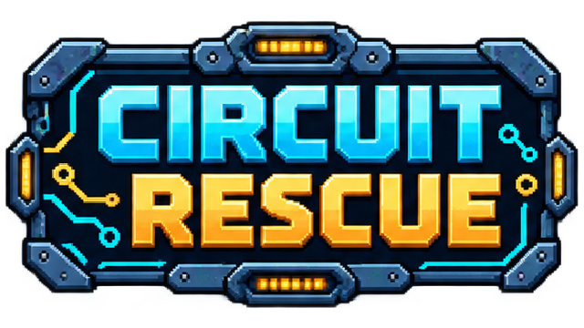

# Circuit Rescue



A pixel-art logic-gate adventure built in **GDevelop 5**. Explore eight space-station sectors, collect components, and repair systems through drag-and-drop circuit dialogs. Activate a rideable mecha in sector 6, then defeat the guardians in sectors 7–8. Opening the optional keyed chest reveals the developer-credits easter egg.

The project filename remains **Animal Hunter.json** for compatibility with existing repository tools. Its game title is **Circuit Rescue**. See the [campaign guide](docs/circuit-rescue-campaign.md) for sector objectives, circuit ports, controls, combat and implementation limits.

## Language and level navigation

New players start in **Bahasa Indonesia**. The speech-bubble/globe icon on the opening/result screens and pause menu switches between Indonesian and English; the selected language is saved in the browser. Standard gate symbols (AND, OR, NOT, XOR, NAND and NOR), the game title, developer names and NIMs remain unchanged. Menus, HUD messages, rules, hints and challenge feedback use the selected language.

The route icon opens all **eight levels**, with no unlock requirement. Selecting one starts a fresh run at that level; levels 7–8 start with the mecha. Every entry shows a paused introduction with the gate concept, binary-signal explanation, worked example and mission. Start Level begins gameplay.

Reaching a powered exit opens **Level Complete** instead of advancing automatically. Choose **Next Level**, **Level List** or **Main Menu**; the final level offers **View Ending**. Returning from the level list restores the completion dialog. Main-menu Play continues with the next level after a completion. Completion badges are saved locally, but the active run, inventory, health and score are still session-only.

The new navigation icons and completion badge use generated artwork in [navigation/](assets/circuit-rescue-v1/navigation/PROMPTS.md). Run `npm run test:localization` and `npm run test:journey` for language and navigation checks; the browser test requires an HTML5 export first.

On mobile, the generated expand/contract control toggles fullscreen for the entire app, including its HTML dialogs and touch controls. Introductions and challenges include their own fullscreen control. A supported browser must receive a user tap; rejected requests show a localized explanation and leave the game usable. On iPhone browser tabs, the control instead offers Safari Home Screen installation instructions on demand. Home Screen web apps are detected through iOS standalone mode and the standard display-mode media queries; fullscreen controls and unsupported warnings are hidden there, since the app already runs without normal browser bars. Unsupported browsers do not show a persistent warning over gameplay. Landscape orientation is requested when supported. Browser/system exit controls remain available.

The mobile game surface blocks page scrolling/overscroll, pinch/double-tap zoom, long-press menus, selection and native image dragging. Single-finger dialog scrolling and editable inputs remain usable; desktop browser defaults are untouched. Run `npm run test:mobile-browser` for fullscreen and gesture-policy checks. These tests simulate iPhone capabilities and standalone state in Chromium; they do not replace physical iPhone/Safari testing.

## Open and play

1. Clone or download this repository, including its `assets/` directory.
2. In GDevelop, choose **Open a project** and open **[Animal Hunter.json](Animal%20Hunter.json)** at the repository root.
3. Preview the project to start at the opening menu, or preview `permainan` directly while developing the level.

The project was last saved with GDevelop **5.6.283**. Use GDevelop to edit and preview it. Node.js **24** is used for optional automated tests and HTML5 exports; install the locked development tools with `npm ci`.

## Controls

| Action | Keyboard / control |
| --- | --- |
| Move | Arrow keys or A / D |
| Jump | Space or W; briefly hold for a higher jump |
| Shoot | J or X; hold to repeat |
| Use terminal / board mecha | E, while near the object |
| Mecha shield | Hold K; release to recharge |
| Pause / continue | P or Escape; pause/play icon |
| Help | H or question-mark icon |
| Replay | R or circular-arrow icon |
| Return to opening | House icon in the pause/result menu |
| Start | Enter or the large play icon |
| View credits | People icon, or open the keyed treasure chest |

Escape closes help/credits. Credits opened from the pause panel return to that paused panel. The play icon closes the chest credits and resumes the adventure.

Phones and touch tablets automatically show generated movement, jump, fire, interact and pause/continue buttons. Desktop computers, narrow desktop windows and mouse-first touch laptops keep the mobile overlay hidden. Detection combines mobile-device hints, touch capability and the primary pointer/hover signals; width alone never enables the controls. Portrait/landscape state updates as the device rotates. Hold multiple controls together to move while firing or jumping. The shield button appears with the mecha. Buttons release on pointer cancellation, focus loss and dialog entry; quick action taps are buffered until the next game frame. Keyboard controls remain available. The fixed 1280×720 game view scales to fit smaller screens so HUD elements remain visible; landscape is recommended. Controls respect screen safe areas. Run `npm run test:mobile` after exporting for browser regression checks; physical-device testing is still needed.

## Gameplay

- **Eight locations / 24 challenges:** a station, warehouse, transit network, tower, reactor, hangar, battlefield and guardian core. Each has three separate terminals across vertical or branching routes.
- **Native platformer physics:** gravity, acceleration, jumping, and terrain collision use GDevelop's Platformer / Platform behaviors.
- **Combat:** patrol drones take two shots and damage the player on contact. They can also be stomped from above.
- **Supplies:** start with 3 health, 3 lives, and 40 rounds. Ammo pickups give 8 rounds, up to 40; medkits restore one health. Each sector requires three component chips.
- **Checkpoints:** the flag restores health and saves a respawn position. Falling or losing all health costs one life.
- **Dialog missions:** predict outputs with draggable 0/1 tokens, repair a wrong chip and broken wire, then build a circuit. Later quizzes include three inputs and a NAND-only interlock. Circuit cables automatically connect in four directions; testing rejects short circuits, feedback and disconnected ports. Incorrect answers consume no components.
- **Progression:** terminals need one, two and three recovered components. Complete all three systems before leaving. The first repair powers a moving lift, the second removes the exit barrier, and all three power the airlock. The keycard is optional and unlocks the credits chest.
- **Mecha:** repair and board it in sector 6. Six hull points, unlimited cannon shots and a rechargeable shield support combat in sectors 7–8.
- **Boss:** a siege guardian in sector 7 and a three-phase Core Guardian in sector 8. Later shield phases require new circuit repairs. Combat pauses during dialogs.
- **Results:** dedicated station-restored and mission-failed scenes show final score and component count, with replay/home controls.
- **Chest easter egg:** the game pauses, the treasure chest opens in a popup, and the developer portraits and credits appear. The reward is granted once per run.
- **Icon HUD:** pause, continue, replay, home, help, and credits use the game's artwork instead of text labels on buttons.

Maps have individual dimensions from 2000–4000 units wide and 1400–2400 units tall. The camera follows both axes; background and HUD remain fixed. Native one-way platforms support climbing and return routes. See [location layouts](docs/location-layouts.json) for dimensions, room positions and route measurements. The giant robot pack has **18 actions with eight frames each (144 frames)**. Mecha frames are 256×256 and boss frames 512×512; original detailed sheets are retained. Normal robot frames remain 128×128. The small robot has 64 recreated source frames, including its own eight-frame Land action; live Idle uses the stable ready pose.

Play continues the current sector during the running session, or the next sector after a completion. The opening replay icon begins a new campaign; gameplay replay restarts the current sector. Active-run progress resets when closing the game; language and completion badges remain in browser storage. Audio, persistent run saves and a full crafting inventory are not implemented yet.

## Repository layout

```text
Animal Hunter.json                 Main GDevelop project
assets/
  circuit-rescue-v1/                Active station, robot, UI, cables and giant robot assets
  cowboy-island-pack-v1/            Player frames, terrain, props, enemies, effects and UI
  animal-hunter-ui-v1/              Title logo and menu/result icons
  developer-portraits-v1/           Supplied developer portraits
  legacy/
    root/                          Earlier loose artwork, preserved for reference
    imports/                       Earlier editor-imported frames and textures
docs/
  game-guide.md                    Scenes, game rules, events and tuning
  chest-credits.md                 Chest reveal and credit details
  asset-audit.json                 Resource-catalog cleanup record
src/events/
  campaign.js                      Sector objectives, circuit dialog/model, mecha and boss controller
  gameplay.js                      Editable game-rule event source
  ui.js                            Shared menu, HUD, pause and credits source
scripts/
  test-circuit-model.mjs           Functional truth-table and invalid-network tests
  generate-circuit-cables.mjs      Exact-grid cable asset generator
  check-project.mjs                Project/resource/JavaScript checks
  sync-events.mjs                  Pull or push event source
package.json                       Optional maintenance commands
.gitignore                         Local recovery/editor/output exclusions
.gitattributes                     Consistent text line endings and binary asset handling
```

`assets/legacy/` preserves older artwork; it does not contain the main player or menu assets used by the current game. Existing generated asset folders keep their names so their manifests and references stay understandable. The active project's resource catalog contains only retained references; obsolete unused registrations were removed without deleting the artwork.

Local backups, autosaves, prepared-project copies, old runtime reports, contact-sheet previews, and one-off import helpers are preserved under **`.local/`** and excluded from Git. Use Git history for shared historical versions. `.git/` and the current branch are unchanged.

## Development workflows

### Editing in GDevelop

1. Open `Animal Hunter.json` and edit scenes, object properties, behaviors, or events.
2. Save the project.
3. If you changed JavaScript events, update the readable source files:

   ```sh
   npm run events:pull
   ```

4. Run the repository checks, then preview the affected scenes in GDevelop:

   ```sh
   npm run check
   ```

### Editing the JavaScript source

1. Close the project in GDevelop to prevent an older open editor state from overwriting the update.
2. Edit `src/events/campaign.js`, `src/events/gameplay.js`, `src/events/ui.js`, `src/events/localization.js` or `src/events/journey.js`.
3. Review the planned synchronization and apply it:

   ```sh
   npm run events:push -- --dry-run
   npm run events:push
   npm run check
   ```

4. Reopen `Animal Hunter.json` and preview the game.

The push command updates matching embedded events and creates an ignored recovery copy in `.local/backups/event-sync/`. UI, localization and journey sources are shared across all eleven scenes; gameplay and campaign sources are shared across eight sectors. Localization initializes first and journey renders/translates last. Pulling stops if shared copies differ. These commands also work as `node scripts/sync-events.mjs pull` / `push` and `node scripts/check-project.mjs`. Run `npm run test:circuits` to verify all lesson functions, guardian phase targets and invalid wiring.

The main project remains the source of truth for scene layouts, object definitions, behaviors, and event structure. Source files and embedded JavaScript are synchronized explicitly; there is no background auto-sync.

## Scenes and event groups

| Scene | Purpose |
| --- | --- |
| `opening` | Title, play, help, credits and exit |
| `permainan` | Sector 1: NOT lesson and adventure |
| `sector2`–`sector5` | AND, OR, XOR and NAND modules |
| `sector6` | Combined circuit and rideable mecha activation |
| `sector7` | NOR module and siege guardian |
| `sector8` | Three-phase Core Guardian and final repairs |
| `winner` | Ending, final run data, replay/home/credits |
| `game over` | Loss result, final run data, replay/home/credits |

Gameplay events are grouped into campaign missions, icon UI, native Platformer controls and game rules. The gameplay source selects player animation once per frame; native animation actions do not compete with it. Normal player frames use recreated **player-v3** images at **128×128** with body mask **(45,32)–(83,112)**. Patrol robots use a fixed body mask **(32,26)–(96,120)** and square 72×72 display size. Mecha uses its own 256×256 frames/body mask, rendered at 192×192. The circuit dialog is an HTML/CSS overlay created by the campaign JavaScript event; the adventure stays native GDevelop. See the campaign guide before changing ports, frame sizes or event ordering.

More detail: [campaign guide](docs/circuit-rescue-campaign.md), [chest and credits guide](docs/chest-credits.md), [station asset guide](assets/circuit-rescue-v1/README.md), [cable guide](assets/circuit-rescue-v1/cables/README.md), and [giant robot animations](assets/circuit-rescue-v1/combat/README.md). The older [game guide](docs/game-guide.md) records the original Animal Hunter implementation.

## Developers

| Developer | Role | NIM |
| --- | --- | --- |
| Syahruzzahid | Programmer | 2405336104 |
| Nazwa Hilmia Zida | Artist | 24053360454 |
| Syarifatus Sholihah | Level Design | 240533602750 |

The in-game credits use the supplied portraits and the names/NIMs above. Generation prompts for the game artwork remain in the corresponding asset folders.

## Checks before a pull request

Run `npm ci` then `npm test` for the complete repository checks. `npm run build:web` creates a local HTML5 export, and `npm run test:browser` exercises the exported campaign. See [tests and deployment](docs/deployment.md) for coverage and commands.

- Run `npm run check`: it checks scene/object references, local resource paths, PNG signatures, registered image references, and embedded JavaScript syntax.
- If you changed event code, confirm source synchronization with `npm run events:push -- --dry-run`.
- Run `npm run test:circuits` for functional circuit-network validation.
- Run `npm run check:combat` to verify eight unique frames per giant-robot action, frame dimensions and file hashes.
- Run `npm run check:actors` to verify actor masks, corrected player frames, patrol proportions and a single animation controller.
- Run `npm run check:maps` to check distinct locations, terminal IDs, supported spawns and platform-route reachability.
- Preview the affected scenes in GDevelop. For gameplay/UI changes, check movement/jumping, pause/continue, replay/home, and the chest-to-credits sequence.
- Commit the project, assets, source, scripts and relevant documentation together. Local backups, autosaves, exported builds and Codex state should stay ignored.

No dependency installation or generated export is required to open the repository in GDevelop.

## GitHub Pages

Play the deployed game at [Circuit Rescue on GitHub Pages](https://zahh-id.github.io/PPLG-PTIC12/). Pushes/PRs run checks, while publishing updates is a separate manual workflow with `publish` defaulting to **false** and deployment limited to `main`. Read the [deployment guide](docs/deployment.md) for release steps.
