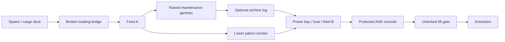

# Campaign map variety and Level 01 art use

Level 01 is an authored dock with four connected zones. Generated sheets now supply actual in-game floor/gantry textures, layered walls/windows, distant architecture and foreground set dressing, in addition to the animated characters, devices and items. Gameplay collision is defined in `shared/mission.js`; decorative props never silently add collision or damage.

## Twin Power layout

| Zone | Authored geometry | Generated art now placed |
| --- | --- | --- |
| Broken loading dock, x0–608 | Spawn, readable 80px breach, ground feed A | Cargo crates, fences, beacon, signage, broken gear, copper wall panels, hazard edges |
| Maintenance gantry, x608–1088 | Lower combat route plus platforms at y384, y336 and y384; optional log | Gantry tile texture, pillars/supports, overhead pipework, valve, lanterns, monitor and vent |
| Power bay, x1088–1440 | Second patrol, recoverable fuse, fixed feed B | Server rack, canister, wall console, structural pillar and warning stripe |
| Control alcove, x1440–1920 | Raised shelter roof, protected defusal area, gate and lift | Roof module, lights, desk, server stack and framed extraction entrance |

A slower backdrop camera carries windows, distant colony architecture and antennas. Structural midground walls change material by zone. Colors and opacity keep collision surfaces, enemies and interactive items distinct. No destructive terrain editing exists in the mission.

## Later levels: deliberate variations, not palette swaps

| Mission | Geometry identity | Appropriate existing/generated asset families |
| --- | --- | --- |
| 02 — Split Route | Two OR-powered transit routes, moving hazards and exposed bridge spans | Glass/metal tiles, solar modules, pipework, colony props; dedicated transit skyline still needed |
| 03 — Mirror Protocol | Archive stacks and shielded rooms, controlled sightlines and an overgrown access wing | Server/console props, lab panels, alien vines/ferns/crystals used as contained research overgrowth |
| 04 — Deadlock | Interlocking relay rooms and vertical foundry routes, turret sightlines | Industrial panels, pipes, gears, warning stripes; dedicated hot-foundry background/effects needed |
| 05 — The Sleeping Giant | Large hangar foreground, on-foot infiltration around the dormant ATLAS cradle | Industrial props plus separate ATLAS body, cradle and boot machinery yet to be generated |
| 06 — Clash of the Giants | Wide two-lane siege arena, boss-scale cover and readable attack lanes | Independent giant-mech/boss families and dedicated arena layers; normal-player sprites must not be enlarged |

Later maps are design targets, not implemented levels. Do not insert every available asset into every level: reserve biome/architecture differences for story progression. Build and playtest each route, then add art without changing its collision rules accidentally.
